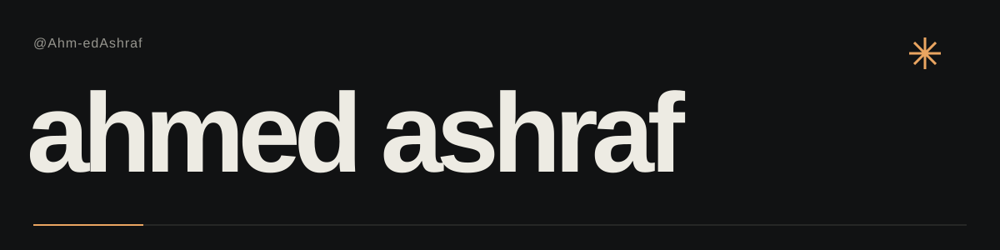

[Portfolio](https://ahm-edashraf.github.io/portofolio/) &nbsp; / &nbsp; [Email](mailto:ahmedashrafyas@gmail.com) &nbsp; / &nbsp; [LinkedIn](https://www.linkedin.com/in/ahmed-ashraf-5ab7bb334/)

I'm a Computer Science student specializing in Data Analytics. I work on web apps, AI automation, and applied ML. Based between Kuala Lumpur, Malaysia and KAEC, Saudi Arabia.

### Selected projects

**[FactoryPulse Lite](https://github.com/Ahm-edAshraf/FactoryPulse-Lite)**

Predictive-maintenance dashboard built for V HACK USM 2026, benchmarked on NASA CMAPSS FD001. Estimates remaining useful life, tracks machine health, and helps prioritize maintenance.

Python · XGBoost · Streamlit · Plotly · SHAP

**[FormAI](https://github.com/Ahm-edAshraf/FormAi)** · [demo](https://formai-ten.vercel.app/)

A form builder that turns plain-English prompts into editable drafts. Includes personal and team workspaces, published snapshots, response analytics, and CSV exports.

Next.js · React · TypeScript · Convex · Clerk · Groq

**[NCR Ride Booking Analytics](https://github.com/Ahm-edAshraf/streamlit-uber-dataset-prediction)**

Booking analytics and ride-completion predictions built around 150,000+ NCR records, with interactive dashboards and a LightGBM model.

Python · Streamlit · LightGBM · scikit-learn · Plotly

More projects

 

**[APU Student Helper](https://github.com/Ahm-edAshraf/apu-student-help)**

Gemini-powered study chat, task and study-time tracking, timetables, deadlines, and a document vault. Supports PDFs, images, documents, and ZIP archives, with PWA and offline support.

Next.js 15 · React 19 · TypeScript · Supabase · Gemini · Tailwind CSS

**[AI Code Reviewer](https://github.com/Ahm-edAshraf/ai-code-reviewer)**

A GitHub App that reviews pull requests with Gemini. Processes webhook events, analyzes chunked diffs, and posts comments categorized by severity.

Python · Flask · Gemini API · GitHub API

**[Resume–Job Matching with NLP](https://github.com/Ahm-edAshraf/resume-parser)**

A Colab-ready notebook for comparing resumes with job descriptions. Uses keyword extraction, semantic embeddings, PDF parsing, weighted similarity scores, and skill-gap analysis.

Python · spaCy · KeyBERT · Sentence Transformers · scikit-learn · PyMuPDF

Technical details

 

- FactoryPulse Lite also detects degradation change points and surfaces sensor drivers, using pandas and ruptures alongside the tools above.
- FormAI uses Next.js 16, React 19, and Tailwind CSS 4. Published form snapshots are immutable.
- The NCR project reports 98.3% AUC across 368 engineered features. It uses pandas for data processing and supports real-time predictions.

### Stack

TypeScript, React, Next.js, and Tailwind for interfaces. Python, Flask, FastAPI, Node.js, and Express for backend work. PostgreSQL and Supabase for storage.

For data and ML: pandas, NumPy, Plotly, scikit-learn, XGBoost, and LightGBM.

Other tools

 

JavaScript, Radix UI, SQLAlchemy, spaCy, KeyBERT, Sentence Transformers, LangChain, OpenAI, Gemini, Git, and GitHub.

GitHub activity

 

<!-- Generated by the existing .github/workflows/profile-summary-cards.yml. -->

---

[ahmedashrafyas@gmail.com](mailto:ahmedashrafyas@gmail.com) · Discord: luhahmed
