<!-- Upload this README and the assets folder to Ahm-edAshraf/Ahm-edAshraf. -->

  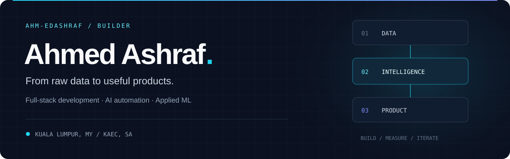

  
  &nbsp;
  
  &nbsp;
  

FULL-STACK DEVELOPMENT &nbsp; / &nbsp; AI AUTOMATION &nbsp; / &nbsp; APPLIED MACHINE LEARNING

## A little context

Hey, I'm **Ahmed** — a Computer Science student specializing in **Data Analytics**, based between **Kuala Lumpur 🇲🇾** and **KAEC 🇸🇦**.

I like building things you can actually use: a form from a sentence, a maintenance decision from sensor readings, a code review from a pull request. My work connects web development, AI automation, and applied machine learning.

## Things I've built

<table>
<tr>
<td width="50%"><a href="https://github.com/Ahm-edAshraf/FactoryPulse-Lite"></a></td>
<td width="50%"><a href="https://github.com/Ahm-edAshraf/FormAi"></a></td>
</tr>
<tr>
<td width="50%"><a href="https://github.com/Ahm-edAshraf/streamlit-uber-dataset-prediction"></a></td>
<td width="50%"><a href="https://github.com/Ahm-edAshraf/apu-student-help"></a></td>
</tr>
<tr>
<td width="50%"><a href="https://github.com/Ahm-edAshraf/ai-code-reviewer"></a></td>
<td width="50%"><a href="https://github.com/Ahm-edAshraf/resume-parser"></a></td>
</tr>
</table>

<a href="https://formai-ten.vercel.app/"><strong>Take FormAI for a spin ↗</strong></a>

<strong>Under the hood — project details &amp; full stacks</strong>

 

- **FactoryPulse Lite:** remaining useful life estimation, machine-health scoring, degradation change-point detection, sensor-driver analysis, and maintenance prioritization. Built with Python, XGBoost, Streamlit, Plotly, pandas, ruptures, and SHAP.
- **FormAI:** visual editing, personal and organization workspaces, immutable public snapshots, response analytics, and CSV exports. Built with Next.js 16, React 19, TypeScript, Tailwind CSS 4, Convex, Clerk, and Groq.
- **NCR Ride Booking Analytics:** more than 150,000 booking records and 368 engineered features; the project reports **98.3% AUC** for its LightGBM model. Built with Python, Streamlit, LightGBM, scikit-learn, Plotly, and pandas.
- **APU Student Helper:** a document vault that processes PDFs, images, documents, and ZIP archives alongside study and scheduling tools. Built with Next.js 15, React 19, TypeScript, Supabase, Gemini, and Tailwind CSS.

<strong>Developer tools &amp; NLP experiments</strong>

 

**[AI Code Reviewer](https://github.com/Ahm-edAshraf/ai-code-reviewer)** — GitHub App that responds to pull-request webhooks, analyzes chunked diffs with Gemini, categorizes findings by severity, and posts structured review comments directly on pull requests.

`Python` `Flask` `Gemini API` `GitHub API`

**[Resume–Job Matching with NLP](https://github.com/Ahm-edAshraf/resume-parser)** — Colab-ready notebook with keyword extraction, semantic embeddings, PDF parsing, weighted similarity scoring, and skill-gap analysis.

`Python` `spaCy` `KeyBERT` `Sentence Transformers` `scikit-learn` `PyMuPDF`

## My working stack

  

<strong>The full toolbox</strong>

 

| Area | Stack |
| :--- | :--- |
| **Interfaces** | Next.js · React · TypeScript · JavaScript · Tailwind CSS · Radix UI |
| **Services** | Node.js · Express · Python · Flask · FastAPI |
| **Data** | PostgreSQL · Supabase · SQLAlchemy · pandas · NumPy · Plotly |
| **Machine learning** | LightGBM · XGBoost · scikit-learn · spaCy · KeyBERT · Sentence Transformers |
| **AI workflows** | LangChain · OpenAI · Gemini |

## Behind the commits

<!-- Keep your existing .github/workflows/profile-summary-cards.yml and generated files. -->

  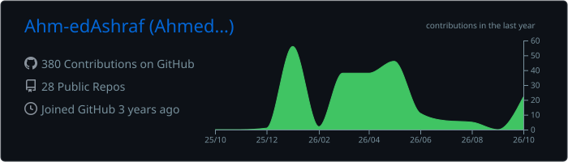

  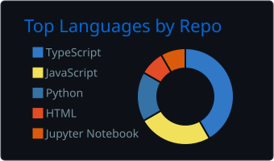
  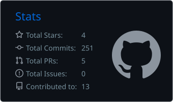

<strong>When the commits happen</strong>

 

  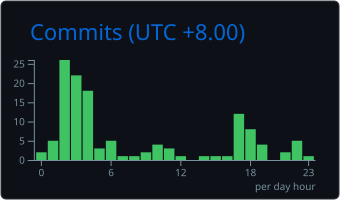

 

<a href="mailto:ahmedashrafyas@gmail.com"></a>

  <a href="https://ahm-edashraf.github.io/portofolio/">Portfolio</a> &nbsp;·&nbsp;
  <a href="https://www.linkedin.com/in/ahmed-ashraf-5ab7bb334/">LinkedIn</a> &nbsp;·&nbsp;
  Discord: <code>luhahmed</code>

  

